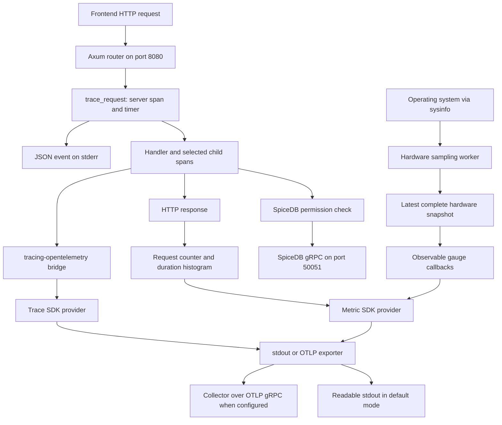

# How the OpenTelemetry changes work

This guide explains the functions added or changed for telemetry on the
`open-telemetry` branch, including the hardware sampler, tests, and campaign
permission fix. Start with [TELEMETRY.md](TELEMETRY.md) for backend/frontend startup
commands and manual testing. This document describes the implementation.

The real server code is in `server/src/telemetry/`. The separate
`telemetry-example/` directory is an earlier learning demo: its application and
permission operations are simulated. The real server does not call that demo.

## 1. What you are looking at

| Term | Meaning in this backend |
| --- | --- |
| Log | An event such as `HTTP request completed`, written as one JSON object per line to stderr. |
| Span | A timed operation, such as one HTTP request or a SpiceDB permission check. |
| Trace | Related spans sharing a trace ID. Child spans show work inside the request. |
| Metric | A measured value or aggregate: CPU usage, memory bytes, request count, request duration. |
| Resource | Metadata identifying the telemetry producer: service name/version, OS type, process ID. CPU readings are **metrics**, rather than resource metadata. |
| Provider | The SDK object managing instruments/spans and their export lifecycle. |
| Exporter | The component delivering telemetry to stdout or an OTLP receiver. |
| Collector | A separate service that receives telemetry and forwards it to storage/visualization systems. This branch does not start one automatically. |

The JSON logger and the OpenTelemetry exporters are separate outputs. In the
startup command from the run guide, stderr goes to `/tmp/chaos-server.jsonl` and
stdout goes to `/tmp/chaos-telemetry.log`. Those filenames are shell redirections,
not hardcoded destinations inside Rust. The stdout exporter produces readable
text; renaming that file to `.json` does not convert its contents.

## 2. The complete flow



SpiceDB is a permission service. An OpenTelemetry Collector is a telemetry
receiver. They use different gRPC APIs and are different destinations.

## 3. How the OpenTelemetry gRPC part works

**gRPC transports telemetry after the backend measures it.** It does not measure
CPU, call every handler, or turn a log file into telemetry.

1. Your Rust code creates spans or records metric values.
2. `tracing-opentelemetry` translates Rust `tracing` spans/events into SDK spans.
3. The SDK prepares trace batches or collected metric aggregates.
4. `opentelemetry-otlp` serializes the export messages using Protocol Buffers.
5. Its `tonic` client sends those messages over gRPC to an OTLP receiver.
6. The receiver forwards the data according to its configured pipelines.

OTLP/gRPC defines separate export services for traces and metrics, using unary
export calls. The standard gRPC receiver port is `4317`.
See the [official OTLP specification](https://opentelemetry.io/docs/specs/otlp/).

In this implementation the relevant builder calls are:

```rust
opentelemetry_otlp::SpanExporter::builder()
    .with_tonic()
    .build()?;

opentelemetry_otlp::MetricExporter::builder()
    .with_tonic()
    .build()?;
```

`with_tonic()` selects the gRPC transport. The branch compiles the
`grpc-tonic` feature. The exporter reads configuration such as
`OTEL_EXPORTER_OTLP_ENDPOINT`; see the
[version 0.32 Rust exporter documentation](https://docs.rs/opentelemetry-otlp/0.32.0/opentelemetry_otlp/).

### What selects the destination?

| Setting | Actual branch behavior |
| --- | --- |
| `OTEL_EXPORTER_OTLP_ENDPOINT` absent | Traces and metrics go to readable stdout. No OpenTelemetry gRPC export is selected. |
| `OTEL_EXPORTER_OTLP_ENDPOINT=http://localhost:4317` | Traces and metrics go to that OTLP gRPC receiver instead of stdout. A receiver must already be listening. |
| `OTEL_SERVICE_NAME` | Resource service name; defaults to `chaos-server`. |
| `TELEMETRY_INTERVAL_SECS` | Hardware delay and metric export interval in seconds; defaults to `5`, must be positive. |
| `RUST_LOG=server=info` | Enables the server's INFO spans/logs. More restrictive filters can suppress request spans and events. |

The branch chooses transport explicitly with `with_tonic()`; setting
`OTEL_EXPORTER_OTLP_PROTOCOL` does not switch this code to an HTTP exporter.
An empty endpoint variable still selects the OTLP branch because the code checks
whether the variable exists. Unset it completely for terminal export.

For a backend running natively, with a collector already available:

```sh
cd "$(git rev-parse --show-toplevel)/backend/server"
OTEL_EXPORTER_OTLP_ENDPOINT=http://localhost:4317 \
OTEL_SERVICE_NAME=chaos-server \
TELEMETRY_INTERVAL_SECS=1 \
RUST_LOG=server=info \
cargo run
```

Use the existing server instance or stop it before starting another on `8080`.
Environment changes take effect at startup. In a container, `localhost` refers to
that container; use the collector's reachable service address instead.

This branch exports **traces and metrics** over OTLP. It does not configure an
OpenTelemetry logs provider/exporter. JSON logs remain on stderr; log events can
also appear as events attached to exported spans. A collector is not itself a
browser dashboard, and this branch does not install a telemetry UI.

### When does data appear?

In stdout mode, completed spans use a simple exporter. In OTLP mode, completed
spans use the SDK's batch exporter, so export is asynchronous rather than one
network call per log line. Metrics use `PeriodicReader` in both modes.

The hardware worker waits for a warm-up interval before publishing its first
snapshot. Sampling and export have independent timers. An export can happen
before a new sample, so it can show the preceding snapshot. Hardware polling
sleeps between polls; OS work adds time to the configured delay. This is
continuous observation, not a hard real-time guarantee.

Graceful shutdown flushes providers. A forced process kill cannot execute the
Rust shutdown function. There is no persistent telemetry queue in this branch.

### How does SpiceDB gRPC relate to traces?

`spicedb::check_permission()` already calls SpiceDB's generated `tonic` client.
The added span times that permission operation and records its allowed result.
It does **not** automatically create a server-side trace inside SpiceDB.

`traceparent` extraction handles incoming **HTTP** trace context. This branch does
not add outgoing trace-context metadata to every SpiceDB, OAuth, S3, or other
client call. HTTP endpoint coverage and distributed tracing across external
services are separate capabilities.

## 4. Server lifecycle functions

Source: [server/src/main.rs](server/src/main.rs).

| Function | Change and purpose |
| --- | --- |
| `main()` | Loads environment settings, initializes `Telemetry`, awaits `run_server()`, then calls telemetry shutdown before returning startup/server errors. |
| `run_server()` | Runs the existing app setup, migrations, seeding, and workers. Startup/bind failures use structured logs. Serves Axum with graceful shutdown, then aborts/joins worker tasks. |
| `shutdown_signal()` | New helper awaiting Ctrl+C or Unix SIGTERM. Lets Axum drain active work before telemetry is flushed. |

`lib.rs` exposes the telemetry module; `main.rs` includes it for the executable.
This is why the same telemetry tests run once for the library and once for the
binary when using `cargo test --lib --bins`.

## 5. Telemetry initialization and HTTP functions

Source: [server/src/telemetry/mod.rs](server/src/telemetry/mod.rs).

| Function | Inputs, output, and behavior |
| --- | --- |
| `Telemetry::init()` | Reads environment configuration; returns `Result<Telemetry>`. Creates trace/metric providers with shared resource metadata; installs JSON logging, the tracing bridge, global meter provider, and W3C propagator. Starts hardware polling on a blocking worker with its own Tokio timer runtime. |
| `Telemetry::shutdown(self)` | Sends the stop flag, awaits the sampler, and shuts down both SDK providers on a blocking worker. Returns sampling/join/export shutdown errors. |
| `SamplingStop::drop()` | Sends `true` on the watch channel when its owner is dropped, including startup unwinding. Wakes the sampler; does not itself flush exporters. |
| `RequestMetrics::new()` | Creates request instruments from the installed global `chaos-http` meter. |
| `RequestMetrics::from_meter(meter)` | Private constructor using a supplied meter. Enables isolated tests without replacing the application's global metric provider. |
| `RequestMetrics::default()` | Delegates to `new()`. |
| `HeaderExtractor::get(key)` | Returns a valid string header value to the trace propagation API. Reads headers for context extraction; does not log their contents. |
| `HeaderExtractor::keys()` | Lists available header names for the propagation API. |
| `trace_request(state, request, next)` | Returns the handler's original response. Creates an `http.request` server span, extracts its incoming parent, times `next.run`, records status/counter/duration, and writes a completion event with the trace ID. |

`Telemetry` owns provider handles, a stop sender, and the sampler task handle.
`RequestMetrics` holds cloneable request counter/histogram handles.
`HeaderExtractor` wraps a borrowed HTTP header map.

### What the HTTP middleware records

- `http.request.method`: GET, POST, PATCH, and other methods.
- `http.route`: the matched template, such as `/api/v1/campaign/:campaign_id`.
- `http.response.status_code`: the returned HTTP status.
- Completion log fields: `trace_id`, `status`, and `duration_ms`.
- `http.server.request.count`: counter, labelled by method/route/status.
- `http.server.request.duration`: histogram in seconds with the same labels.

The timer stops when Axum produces the response object; it does not measure the
complete delivery of a streaming response body. Unknown paths use `unmatched`
rather than arbitrary URLs. Payloads, query strings, cookies, and authorization
headers are not recorded by this middleware. Some business child spans do record
user/resource IDs as attributes, so the entire trace is not anonymous.

HTTP `5XX` results mark the request span as ERROR. A `403` still has a recorded
status and rejection event, but is not marked as a server-error span. The tests
verify that behavior. A request that never completes cannot emit a completion
event until it finishes; process termination/panics are not a normal response.

### Why every endpoint is included

Source: [server/src/models/app.rs](server/src/models/app.rs), `app()`.

The existing router registers all routes, adds CORS, then adds `trace_request` as
its outer layer. No per-handler annotation is needed for the HTTP span.
Authentication rejections and CORS preflight responses also pass through it.
New routes must be registered **before** this layer is applied to inherit coverage.

The verified branch snapshot has 90 distinct paths and 114 explicitly registered
method/path combinations. The live coverage check sent OPTIONS preflight requests
to all 90 paths and found a completion log for each. It did not execute every
handler's business logic. Frontend rendering, direct browser uploads to S3, and
background work outside an HTTP request are not additional backend endpoints.

## 6. Hardware polling functions

Source: [server/src/telemetry/performance.rs](server/src/telemetry/performance.rs).

| Function | Inputs, output, and behavior |
| --- | --- |
| `validate_interval(interval)` | Returns an error if the delay is below `sysinfo::MINIMUM_CPU_UPDATE_INTERVAL`. CPU usage needs a baseline and a later measurement. |
| `sample_performance(provider, stop, interval)` | Returns `Result<()>`. Primes CPU/process data; initializes OS sources; repeatedly reads real host/process measurements and supplies complete snapshots to `run_sampling`. Missing or nonfinite temperatures are omitted. |
| `run_sampling(recorder, stop, interval, poll)` | Private generic loop. Waits before each poll, publishes its snapshot, and stops on `true` or channel closure. A false watch update does not stop it. Poll/publish errors return to the worker, which logs that sampling stopped. |

The `poll` closure inside `sample_performance` contains the actual sysinfo refresh
and snapshot-building logic. It logs `Performance sample recorded` with average
host CPU, used RAM bytes, and sensor count. That summary log is not the full
metric payload.

Source: [server/src/telemetry/performance/recording.rs](server/src/telemetry/performance/recording.rs).

| Type/function | Purpose |
| --- | --- |
| `ReadingValue` | Stores a floating-point or unsigned integer value. |
| `Reading` | One metric name, value, and identifying attributes. |
| `HardwareSnapshot` | All readings from one poll. Missing readings are omitted. |
| `SnapshotRecorder` | Stores the latest snapshot behind `Arc<RwLock<...>>` and retains observable instrument handles. |
| `SnapshotRecorder::new(provider)` | Registers 11 observable gauges. Their callbacks read the latest snapshot when the SDK collects metrics. Float callbacks omit NaN/infinity; availability is computed from valid temperatures. |
| `SnapshotRecorder::publish(snapshot)` | Replaces the stored snapshot under a write lock. Returns a lock-poisoning error if the lock cannot be acquired. |
| `HardwareSnapshot::float(name, value, attributes)` | Appends a floating-point reading with copied attributes. |
| `HardwareSnapshot::integer(name, value, attributes)` | Appends an integer reading without converting byte values to floats. |
| `HardwareSnapshot::temperature_count()` | Counts finite temperature readings in the current snapshot. |

Observable callbacks report the current snapshot rather than retaining all values
ever recorded. A removed sensor/interface is omitted at the next collection.
A failed sampler stops publishing, however, so the last stored snapshot can remain
visible; the worker's error log is relevant when readings stop changing.

### Hardware metric reference

| Name | Unit | Attributes / interpretation |
| --- | --- | --- |
| `chaos.host.cpu.usage` | `%` | `cpu=average` or logical CPU index. |
| `chaos.host.cpu.frequency` | `MHz` | `cpu` index; unavailable/zero frequency omitted. |
| `chaos.host.memory` | `By` | `state=used`, `available`, `total`. |
| `chaos.host.swap` | `By` | `state=used`, `total`. |
| `chaos.host.load_average` | `1` | `window=1m`, `5m`, `15m`; load is not a CPU percentage. |
| `chaos.process.cpu.usage` | `%` | Current server process; may exceed 100% across cores. |
| `chaos.process.memory` | `By` | `kind=resident` or `virtual`; virtual memory is not physical RAM use. |
| `chaos.host.disk.space` | `By` | `mount`, `state=available` or `total`; capacity, not disk read/write throughput. |
| `chaos.host.network.bytes_since_previous_sample` | `By` | `interface`, `direction=receive` or `transmit`; bytes per poll, not a cumulative counter or bytes/second. |
| `chaos.host.sensor.temperature` | `Cel` | `sensor` label; may include sensors other than CPU depending on OS/hardware. |
| `chaos.host.temperature.available` | `1` | 1 when at least one finite sensor value exists; otherwise 0. |

These `chaos.*` names are custom metrics. OS/container visibility determines what
can be measured. The sampler does not measure frontend JavaScript performance,
GPU usage, every machine on your network, or CPU consumed by one specific request.

## 7. Existing business functions changed for tracing

These functions already existed; their business implementations were not created
as telemetry examples.

| Source/function | What was added |
| --- | --- |
| [spicedb/mod.rs](server/src/spicedb/mod.rs): `check_permission()` | A child span with user/resource IDs and an `allowed` result. Intended fields also include resource type and permission. Uses `skip_all` to avoid dumping the client, key, or lock. A denied permission returns `ForbiddenOperation`; a call failure returns an internal error. |
| [models/transaction.rs](server/src/models/transaction.rs): `DBTransaction::commit()` | A child span with queued relationship count and returned error events. Existing behavior commits PostgreSQL first and applies the SpiceDB batch afterward. PostgreSQL success is not a cross-system atomic transaction; SpiceDB write failures are logged by the existing implementation. |
| [handler/application.rs](server/src/handler/application.rs): `ApplicationHandler::submit()` | `application.submit` span, application ID, and error event if its Result is Err. Extractor rejections can happen before the function body/span runs. |
| [models/application.rs](server/src/models/application.rs): `Application::submit()` | Nested `application.persist_submission` span for persistence, application ID, and returned error event. |
| [models/error.rs](server/src/models/error.rs): `ChaosError::print()` | Replaces println output with structured WARN for expected rejections and ERROR for system failures. Uses the error's Display representation; several variants show a generic category such as `SQLx error`, rather than full underlying details. |

`#[tracing::instrument(...)]` creates a span around a function invocation.
`skip_all` avoids automatic recording of arguments. Explicit `fields(...)`
choose useful attributes. `err` attaches an event for an Err return. These few
annotations do not instrument every database query or every internal function.

## 8. Campaign permission and local data changes

Source: [spicedb/schema.yaml](spicedb/schema.yaml).

Campaign management now inherits `organisation->manage` instead of directly
checking `organisation->admin`. Organisation `manage` already includes admins
and platform superusers. This makes banner updates use the same superuser
management permission as campaign creation. It does not change the separate
campaign `review` permission, which still uses organisation members/admins.
A `403` on a review endpoint can therefore be a separate permission issue.

The local repair touched the authorized account's platform superuser relationship
and added the missing organisation-to-platform relationship. The repair scripts
were temporary development utilities under `/tmp`, not server functions or a
production migration. No credentials belong in this documentation.

The schema is embedded using `include_str!` and applied by the existing
`spicedb::migrate_schema()` at startup. Rebuild after editing the schema so a
future startup applies the new version. Existing relationships were preserved
when the corrected schema was applied locally.

## 9. HTTP test function reference

Source: [server/src/telemetry/tests.rs](server/src/telemetry/tests.rs).

| Function | Expected result |
| --- | --- |
| `request(method, uri, status)` | Helper: builds an isolated router/exporters/subscriber, executes the real middleware, checks response and metric export, returns exported span and metric exporter. No app DB operations. |
| `attribute(span, key)` | Helper: retrieves an exported attribute as a string. |
| `assert_metrics(exports, method, status)` | Helper: verifies one request count and one finite nonnegative duration observation, correct labels, and seconds unit. |
| `records_all_http_methods()` | GET/POST/PUT/PATCH/DELETE/HEAD/OPTIONS each export a server span and metrics. |
| `records_rejected_requests()` | 400/401/403 are recorded; span status stays Unset rather than server ERROR. |
| `marks_server_failures_as_errors()` | HTTP 500 yields ERROR span status. |
| `records_unmatched_routes()` | 404 is recorded as `unmatched`, without the arbitrary URL in the span. |
| `propagates_incoming_trace_context()` | Exported trace and parent span IDs match the supplied W3C header. |
| `excludes_sensitive_request_data()` | Span/metric output omits the test body's secret, cookie, authorization value, query secret, and raw path ID. |

The helper installs the same W3C propagator globally; test subscribers and SDK
exporters are isolated. These tests validate exported spans/metrics, not the
format of every application log message.

## 10. Hardware test function reference

Source: [server/src/telemetry/performance/tests.rs](server/src/telemetry/performance/tests.rs).

| Function | Expected result |
| --- | --- |
| `exporter()` | Helper: creates an isolated SDK meter provider and in-memory metric exporter. |
| `points(exporter, name, unit)` | Helper: reads exported gauge values/labels and checks type/unit. |
| `reading(...)` | Helper: constructs expected test readings. |
| `rejects_zero_interval()` | Zero delay returns an error before OS polling. |
| `respects_shutdown_already_requested()` | An initially true stop flag exits promptly. |
| `exports_expected_hardware_values_and_units()` | Controlled CPU/RAM/process/disk/network/temperature values and labels export with expected units. |
| `unavailable_temperatures_are_not_fabricated()` | Missing/NaN/infinite values do not produce temperatures; availability is 0. |
| `replaces_old_values_and_retracts_disconnected_devices()` | Updated readings replace prior values and missing sensors/interfaces disappear. |
| `rejects_interval_below_cpu_minimum()` | Too-short CPU sampling delay returns an error. |
| `waits_for_cpu_warmup_before_polling()` | Poll does not happen before the initial interval. |
| `polls_continuously_and_exports_updated_values()` | Successive values export; false stop update continues; true stops. |
| `closed_shutdown_channel_stops_sampling()` | Dropping the stop sender lets the loop exit. |
| `propagates_hardware_poll_failures()` | A failing poll returns its error rather than reporting a successful sample. |

These use controlled snapshots, so test expectations do not depend on real CPU
load or having temperature sensors on the test machine.

## 11. SpiceDB integration test function reference

Source: [spicedb/test_campaign_permissions.py](spicedb/test_campaign_permissions.py).

| Function | Purpose / expected result |
| --- | --- |
| `setUpClass()` | Reads local Compose connection settings and creates uniquely named permission fixtures. Registers cleanup before writing fixtures. |
| `object(kind, suffix)` | Creates a test-specific resource reference. |
| `relationship(resource, relation, subject)` | Builds one SpiceDB relationship. |
| `api(path, payload)` | Calls local SpiceDB's HTTP gateway at 8443 without printing its key. The test transport is HTTP; the real Rust permission client uses gRPC. |
| `write(operation)` | Applies all fixture relationships in one batch. |
| `cleanup()` | Deletes only this test's fixture relationships. |
| `assert_manage(role, allowed)` | Checks campaign management using fully consistent reads. |
| `test_superuser_can_manage_campaign()` | Global superuser granted. |
| `test_admin_can_manage_campaign()` | Organisation admin granted. |
| `test_member_cannot_manage_campaign()` | Ordinary member denied. |
| `test_outsider_cannot_manage_campaign()` | Unrelated account denied. |

## 12. Earlier demo function reference

Sources: [telemetry-example/src/main.rs](telemetry-example/src/main.rs) and
[telemetry-example/src/performance.rs](telemetry-example/src/performance.rs).

| Function | Behavior |
| --- | --- |
| `init_telemetry()` | Creates demo stdout exporters and human-readable logging; returns providers for shutdown. |
| `load_roles(application_id)` | Simulates a database delay and returns fixed role names; no PostgreSQL lookup. |
| `check_permission(deny)` | Simulates allowed/denied permission results; no SpiceDB call. |
| `process_application(application_id, deny)` | Runs simulated permission/role work in a trace, logs its trace ID, and records success/error. |
| `main()` | Runs success/failure demonstrations and a finite OS sampler; reads `DEMO_SAMPLES`/`DEMO_INTERVAL_MS`; awaits sampling and shuts down providers. |
| `performance::sample_performance(provider, samples, interval)` | Reads real OS metrics for a finite number of samples using synchronous gauges, sleeping and explicitly flushing each sample. The real server uses the continuous observable-snapshot design instead. |

`SAMPLE_OUTPUT.txt` is a captured learning artifact, not a live source of server
telemetry. The demo's simulated permission messages are unrelated to your real
account's permission results.

## 13. Validation and limitations

Last verified during this branch work:

- 16 unique Rust telemetry tests passed: six HTTP and ten hardware tests. They
  run in both the library and binary test targets.
- Four local SpiceDB campaign permission integration tests passed.
- All 90 registered route paths produced live preflight completion telemetry.
- Rust formatting and whitespace checks passed.
- The unrestricted documentation suite has 40 existing failing examples, mostly
  generated protobuf snippets plus an existing OAuth example. It is not green.

From the repository root:

```sh
python3 backend/spicedb/test_campaign_permissions.py
cd "$(git rev-parse --show-toplevel)/backend/server"
cargo test --lib --bins
```

Local database/configuration is needed for SQLx compilation; the Rust telemetry
unit tests themselves use isolated exporters and controlled inputs. See the run
guide for environment setup and the narrower test commands.

The preceding checks do not claim every endpoint's business behavior works or
that an OTLP collector received data. The live route check used OPTIONS, and the
unit tests used in-memory exporters. This branch supports OTLP gRPC export, but
collector ingestion, downstream storage, and dashboard setup require their own
end-to-end verification in the environment where you run them.
